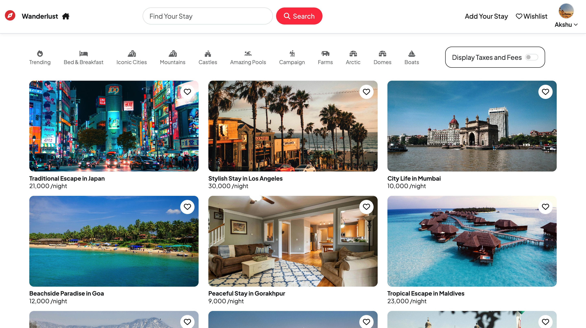
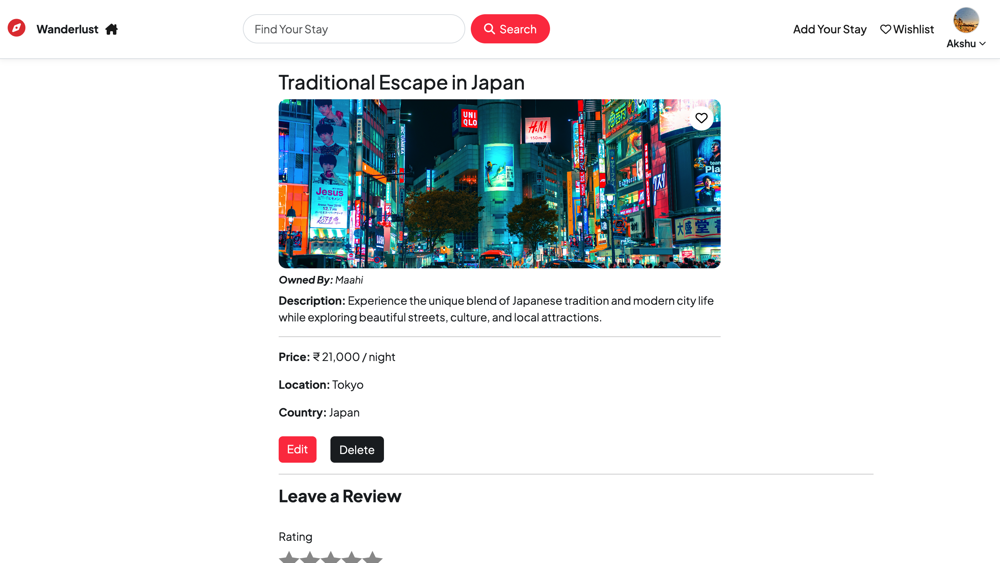
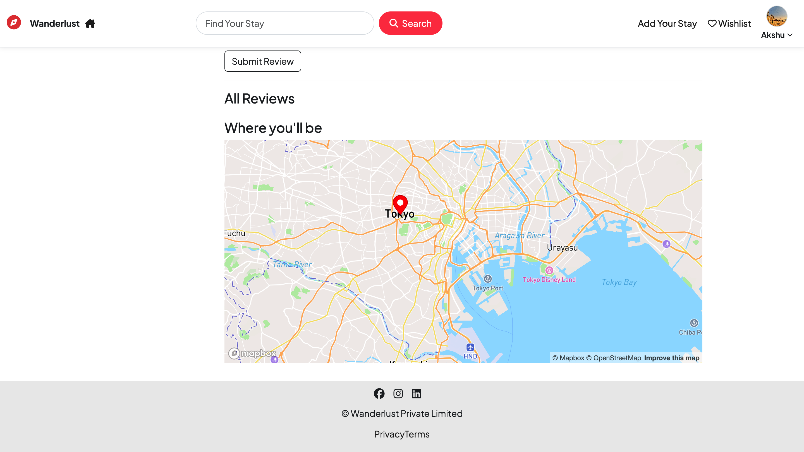

 <div align="center">

# 🌍 Wanderlust

### A Full-Stack Accommodation Platform to Discover, Create, Save, and Review Stays

[🌐 **Live Demo**](https://wanderlust-imfd.onrender.com/listings)

`Node.js` · `Express.js` · `MongoDB` · `EJS` · `Passport.js` · `Cloudinary` · `Mapbox`

</div>

---

## 📸 Screenshots

### 1. Homepage


### 2. Homepage After Login



### 3. Listing Details



### 4. Location Section



---

## ✨ Features

- 🔐 **Authentication** — Signup, login, logout, sessions, and protected routes.
- 🏡 **Listings** — Create, view, edit, and delete accommodation listings.
- 🔎 **Search & Categories** — Search by title, location, and country with category filtering.
- ❤️ **Wishlist** — Save and manage favorite listings.
- ⭐ **Reviews & Ratings** — Add reviews and 1–5 star ratings.
- 🗺️ **Interactive Maps** — Display listing locations using Mapbox.
- 🖼️ **Image Uploads** — Cloudinary-based image storage.
- 💰 **Tax Toggle** — Optional 18% GST display.
- 🛡️ **Authorization** — Users can modify only their own listings and reviews.
- ✅ **Validation & Error Handling** — Joi, Mongoose, and custom Express middleware.
- ☁️ **Deployment** — Render and MongoDB Atlas.

---

## 🛠️ Tech Stack

| Layer | Technologies |
|---|---|
| Frontend | EJS, HTML5, CSS3, JavaScript, Bootstrap |
| Backend | Node.js, Express.js |
| Database | MongoDB, Mongoose, MongoDB Atlas |
| Authentication | Passport.js, Passport Local |
| Sessions | Express Session, Connect-Mongo |
| Validation | Joi, Mongoose |
| Images | Cloudinary, Multer |
| Maps | Mapbox |
| Utilities | Method Override, Connect-Flash |
| Deployment | Render |

---

## 🏗️ Architecture

Wanderlust follows the **MVC (Model–View–Controller) architecture**.

```text
Browser
   ↓
EJS Views
   ↓
Express Routes
   ↓
Middleware
   ↓
Controllers
   ↓
Mongoose Models
   ↓
MongoDB
```

External service integrations:

```text
Cloudinary → Image Storage
Mapbox     → Geocoding & Maps
MongoDB    → Application Data
Render     → Deployment
```

---

## 📂 Project Structure

```text
Wanderlust/
├── controllers/
├── models/
├── routes/
├── views/
├── public/
├── utils/
├── middleware.js
├── schema.js
├── cloudConfig.js
├── app.js
├── package.json
└── README.md
```

---

## 🔄 Core Workflow

```text
User
  ↓
Authentication
  ↓
Explore Listings
  ↓
Search / Categories
  ↓
View Listing
  ├── Map
  ├── Reviews
  └── Wishlist
  ↓
Create / Edit / Delete Own Listings
```

---

## 🔐 Security & Validation

The application implements:

- Passport Local authentication
- Session-based login
- Ownership-based authorization
- Joi request validation
- Mongoose schema validation
- Protected listing and review routes
- Custom error handling
- Flash messages for user feedback

---

## ☁️ Integrations

### Cloudinary

Handles listing image uploads and cloud storage.

### Mapbox

Converts listing locations into geographic coordinates and displays them on interactive maps.

### MongoDB Atlas

Provides persistent cloud database storage for users, listings, reviews, and wishlist data.

---

## 🚀 Run Locally

### 1. Clone the Repository

```bash
git clone https://github.com/jhasabhishek17/wanderlust.git
cd wanderlust
```

### 2. Install Dependencies

```bash
npm install
```

### 3. Create a `.env` File

Add the following environment variables:

```env
ATLASDB_URL=your_mongodb_connection_string
SECRET=your_session_secret
MAP_TOKEN=your_mapbox_token
CLOUD_NAME=your_cloudinary_cloud_name
CLOUD_API_KEY=your_cloudinary_api_key
CLOUD_API_SECRET=your_cloudinary_api_secret
```

### 4. Start the Application

```bash
node app.js
```

For development with automatic restarts:

```bash
nodemon app.js
```

Open the application at:

```text
http://localhost:8080
```

---

## 🎯 What This Project Demonstrates

Wanderlust brings together practical full-stack development concepts:

**CRUD Operations · MVC Architecture · Authentication · Authorization · MongoDB Relationships · RESTful Routing · Validation · API Integration · Cloud Storage · Search & Filtering · Sessions · Deployment**

---

## 🔮 Future Improvements

- 📅 Booking and availability management
- 💳 Online payments
- 💬 Host–guest messaging
- 🔔 Notifications
- 📊 Host dashboard
- 🔍 Advanced filtering
- 🤖 Personalized recommendations

---

## 👨‍💻 Author

**Abhishek Jha**

B.Tech — Electronics & Communication Engineering

**Interests:** Full-Stack Development · Backend Development · Cloud & DevOps · AI & Automation

---

<div align="center">

### 🌍 Explore Wanderlust

[**Open Live Demo →**](https://wanderlust-imfd.onrender.com/listings)

⭐ If you like this project, consider giving the repository a star!

</div>